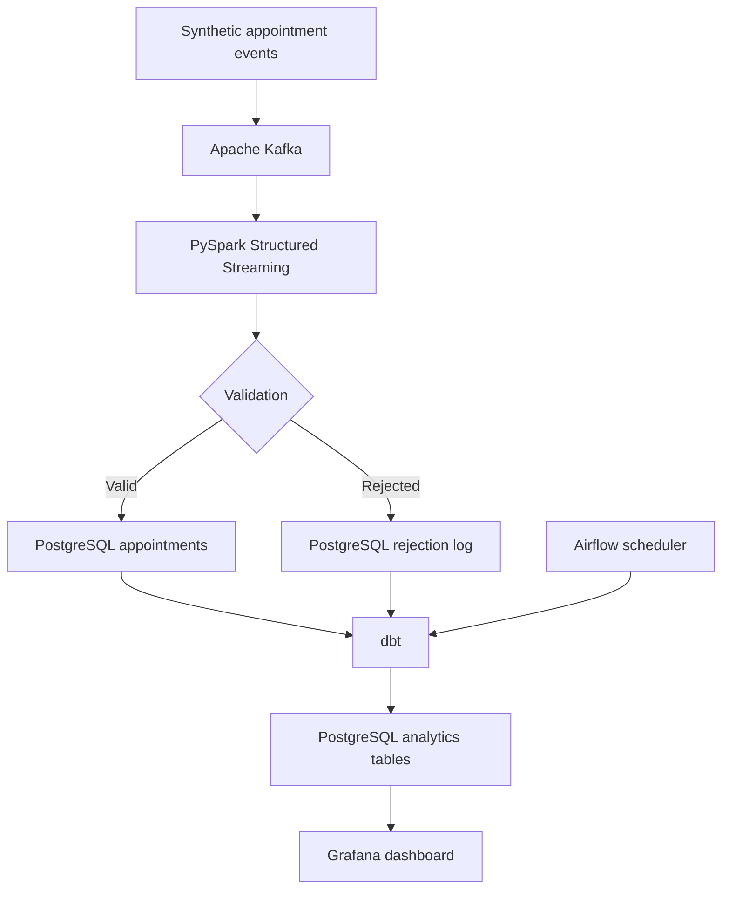

# Healthcare Operations Data Pipeline

Stream synthetic appointment events, validate them, and report appointment and lab test counts by department.



## Start the streaming stack

From the repository root, use Docker with Compose v2 and Python 3.10 or later.

```bash
docker compose up --build --wait --wait-timeout 240
set -o pipefail
python3 scripts/publish_sample.py |
  docker compose exec -T kafka /opt/kafka/bin/kafka-console-producer.sh \
    --bootstrap-server kafka:9092 --topic healthcare.appointments \
    --property parse.key=true --producer-property acks=all
```

Check that Spark committed the batch.

```bash
docker compose logs -f streaming
```

The fixture produces **3 valid events**, **3 lab tests**, and **1 rejected event**. Airflow runs `dbt build` every five minutes. To refresh immediately after ingestion, open the Airflow DAG, sign in with `admin` / `admin`, and trigger the DAG. Once the build succeeds, sign in to Grafana with `admin` / `admin` to view department totals, appointment status counts, and rejection reasons. [Airflow DAG](http://127.0.0.1:8080/dags/healthcare_analytics/grid) · [Grafana dashboard](http://127.0.0.1:3000/d/healthcare-operations/healthcare-operations)

The UIs bind to loopback addresses and the stack uses demo credentials for synthetic data.

## Event and warehouse behavior

- Publish UTF-8 JSON to `healthcare.appointments` with the appointment ID as the Kafka key. The event fields are `appointment_id`, `department`, `status`, and `lab_tests`. IDs and departments must be nonblank strings of up to 128 characters after trimming. Statuses are `completed`, `cancelled`, or `scheduled`. Lab test counts are nonnegative 32-bit integers, with decimal strings accepted for CSV input.
- The sample publisher omits the fixture's `patient_id`. Spark stores the validated fields and Kafka metadata in PostgreSQL. Rejections store a reason code and Kafka coordinates and timestamp. Query `raw.appointments` and `raw.rejected_events` to inspect both routes.
- Spark checkpoints Kafka offsets and commits each micro-batch in one PostgreSQL transaction. The unique topic, partition, and offset key prevents duplicate writes when Spark retries a batch.
- dbt builds `analytics.department_metrics` from the latest valid event per appointment and `analytics.rejection_metrics` from all rejected events. Grafana uses a PostgreSQL role with read access to those analytics tables.

```bash
docker compose exec -T postgres psql -U postgres -d healthcare \
  -c 'SELECT * FROM raw.rejected_events ORDER BY kafka_timestamp;'
docker compose down
```

`docker compose down` keeps the Kafka, PostgreSQL, Spark, and UI volumes. To erase the demo and start fresh, use `docker compose down --volumes` so the Kafka offsets, checkpoint, and warehouse are reset together.

## Tests and performance

### Unit and integration tests

| Test | Coverage | Result on 2026-11-19 |
| --- | --- | --- |
| Python unit tests | SQLite batch processing and streaming event validation, including malformed JSON, invalid fields, and numeric boundaries | 7 passed in 0.033 s of unittest time |
| Compose smoke test | Kafka ingestion, accepted and rejected rows in PostgreSQL, appointment deduplication in dbt, and dashboard totals through Grafana's API | Passed after Airflow restart. Grafana returned 3 appointments, 3 lab tests, and 2 rejections. |

Run the smoke test on a fresh Compose project before publishing the sample manually. The smoke test sends six messages and checks four accepted raw events and two rejected events before triggering the Airflow DAG. The dbt build checks required fields, allowed statuses, and uniqueness in the analytics tables.

```bash
python3 -m unittest discover -s tests -v
export COMPOSE_PROJECT_NAME=healthcare-smoke
docker compose up --build --wait --wait-timeout 240
bash scripts/smoke.sh
```

The smoke test uses the default local Airflow and Grafana ports, 8080 and 3000. The recorded run used Docker Engine 29.8.0 and Compose v5.5.1 on a shared host. Its temporary Compose configuration and smoke script used 18080 and 13000 because the default ports were occupied. The Kafka health check timed out with the default 10-second timeout, so the temporary configuration used a 45-second timeout and a 30-second interval.

The first smoke attempt verified PostgreSQL ingestion, then timed out waiting for the Airflow API. Airflow logged that its Gunicorn master failed to respond within 120 seconds. The retry used two web workers, a 360-second master timeout, and a 180-second worker timeout. It resumed the smoke checks using the six events already recorded in PostgreSQL.

### Python validation benchmark

On 2026-11-19, CPython 3.14.4 classified 100,000 pre-generated UTF-8 JSON payloads in memory on an Intel Core i5-8365U host with 14.7 GiB RAM. The payloads followed the same pattern as the load test below. Each of the five passes called `src.streaming.classify` once per payload and counted 99,000 accepted and 1,000 rejected events. The measured times were 1.039 s, 1.293 s, 0.981 s, 1.515 s, and 1.597 s. The median was **1.293 s**, about **77,300 events/s**. Timing used `time.perf_counter()` around the classification loop and excluded payload generation and all container services.

### Local ingestion load test

On 2026-11-19, the local Kafka → Spark → PostgreSQL path processed all **10,000 events in 111 seconds**, averaging **90.1 events/s**. This was one run on the same shared host after the smoke checks completed.

| Measurement | Result |
| --- | ---: |
| Kafka publish time | 20 s |
| Publish start to all rows observed in PostgreSQL | 111 s |
| Accepted rows | 9,900 |
| Rejected rows with `invalid_status` | 100 |

The elapsed time includes producer startup, the Kafka offset check after publishing, and polling PostgreSQL for the committed rows. It measures ingestion through PostgreSQL. Airflow, dbt, and Grafana are covered by the smoke test.

The workload contains 10,000 keyed JSON events with unique appointment IDs. Every 100th event has an invalid status. Run the workload after the smoke test with the same Compose project running and no other producers publishing. Spark uses two local execution threads, a five-second trigger, and a limit of 1,000 Kafka offsets per trigger across three partitions.

Capture the latest offsets before and after publishing.

```bash
docker compose exec -T kafka /opt/kafka/bin/kafka-get-offsets.sh \
  --bootstrap-server kafka:9092 --topic healthcare.appointments --time latest
```

```bash
set -o pipefail
started=$SECONDS
python3 - <<'PY' |
import json

for index in range(10_000):
    appointment = f"load-{index}"
    event = {
        "appointment_id": appointment,
        "department": "Cardiology",
        "status": "invalid" if index % 100 == 0 else "completed",
        "lab_tests": 1,
    }
    print(appointment, json.dumps(event, separators=(",", ":")), sep="\t")
PY
  docker compose exec -T kafka /opt/kafka/bin/kafka-console-producer.sh \
    --bootstrap-server kafka:9092 --topic healthcare.appointments \
    --property parse.key=true --producer-property acks=all
printf 'Publish time: %s s\n' "$((SECONDS - started))"
```

Poll `raw.ingested_events` for rows in the offset ranges recorded for each partition. Include the start offset and exclude the end offset. The run is complete once PostgreSQL shows 9,900 rows with a null `rejection_reason` and 100 rows with `invalid_status` in those ranges. At that point, `$((SECONDS - started))` gives the elapsed time when using the same shell. Divide 10,000 by that duration for the average ingestion rate.

Delete the isolated project's containers and test data when finished.

```bash
docker compose -p healthcare-smoke down --volumes
unset COMPOSE_PROJECT_NAME
```

## SQLite starter

The original dependency-free batch example uses the same fixture and writes `clean.jsonl`, `rejected.json`, `warehouse.db`, and `summary.json` to `output/`. Use `sql/analysis.sql` with the SQLite database.

```bash
python3 -m src.pipeline
```
